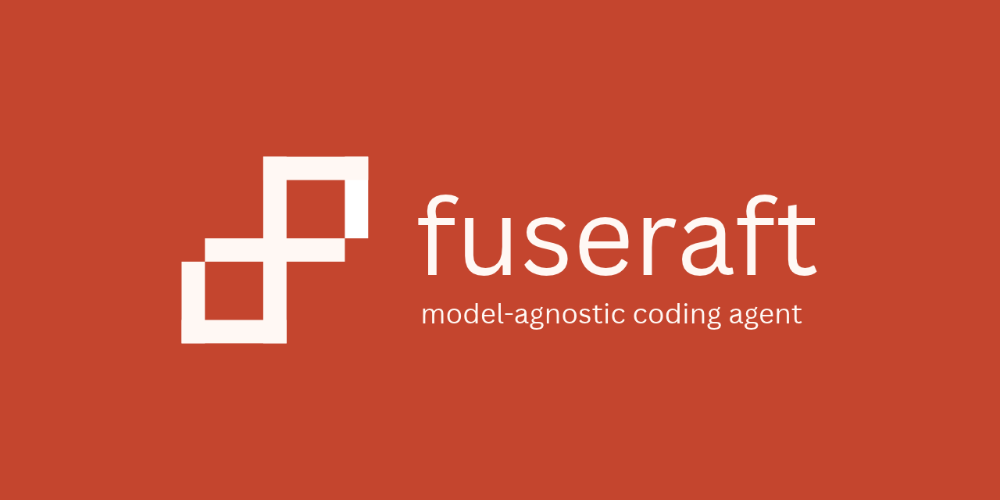
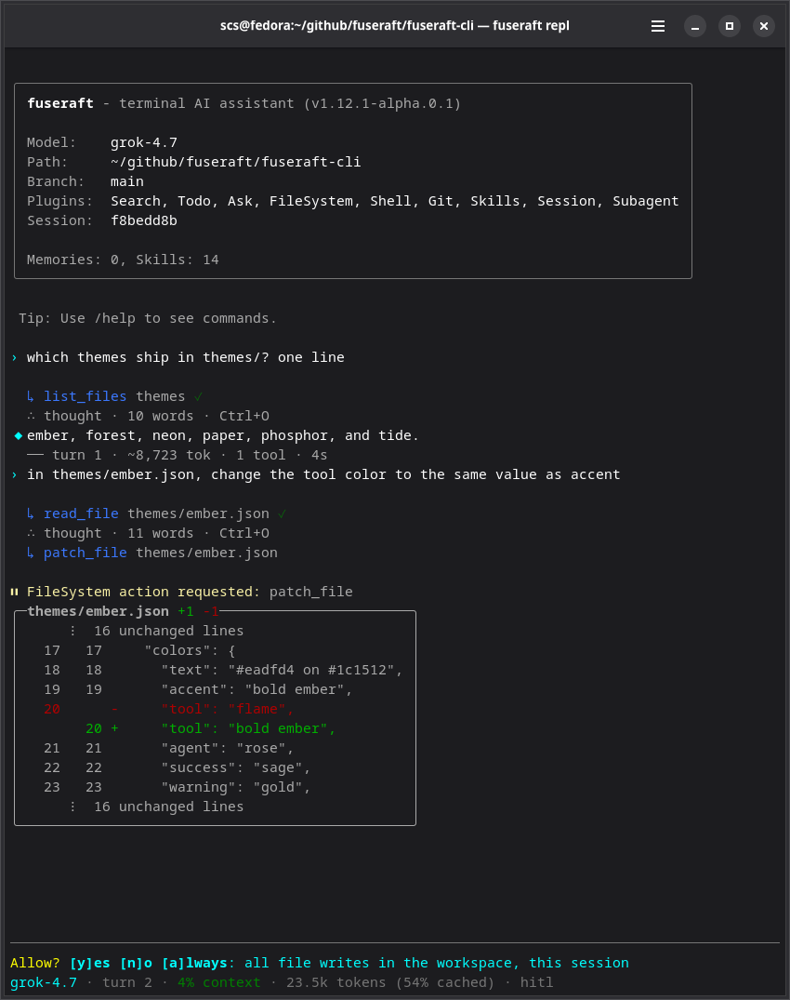
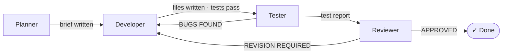

# fuseraft

[](https://github.com/fuseraft/fuseraft-cli/actions/workflows/ci.yml)
[](https://github.com/fuseraft/fuseraft-cli/releases)
[](LICENSE.md)
[](https://github.com/fuseraft/fuseraft-cli/stargazers)



**A coding agent for your terminal that works with any model, and asks before it changes anything.**

Run `fuseraft` and chat with a model that reads and edits your files, runs commands, searches your code and uses git. Bring your own key, or run a local model. When one agent isn't enough, run a team of them that has to prove its work before handing off.

```bash
curl -fsSL https://raw.githubusercontent.com/fuseraft/fuseraft-cli/main/install.sh | bash
fuseraft
```

**[Documentation](https://fuseraft.ai/fuseraft-cli/)** · [Getting started](https://fuseraft.ai/fuseraft-cli/getting-started/) · [Releases](https://github.com/fuseraft/fuseraft-cli/releases)



## Why fuseraft

- **Your model, your key.** Anthropic, OpenAI, xAI, Google, Mistral, DeepSeek, Azure, Ollama, or any OpenAI-compatible endpoint. Switch mid-chat with `/model`. Keys live in your OS keychain, not a dotfile.
- **Asks before it acts.** Shell commands, file writes and git changes wait for your approval, with a diff for every edit, and the agent can't leave the directory you started in.
- **Teams that prove their work.** Define a team of agents in YAML. Before any handoff, deterministic validators check the evidence: files on disk, test exit codes, tool-call records. No model grades another model's homework.
- **One binary, no runtime.** Self-contained builds for Linux, macOS (Intel and Apple silicon) and Windows. `fuseraft update` keeps it current.
- **Wherever you work.** In the terminal, in [VS Code](https://marketplace.visualstudio.com/items?itemName=fuseraft.fuseraft) ([Open VSX](https://open-vsx.org/extension/fuseraft/fuseraft) too), in the browser with [fuseraft-web](https://fuseraft.ai/fuseraft-web/), or as a daemon other agents send work to over MCP.

Open source under MIT, built on [Microsoft Agent Framework](https://github.com/microsoft/agent-framework).

## Install

Prebuilt binaries are self-contained; you don't need .NET.

```bash
# Linux / macOS (end with `bash -s -- --system` to install to /usr/local/bin)
curl -fsSL https://raw.githubusercontent.com/fuseraft/fuseraft-cli/main/install.sh | bash
```

```powershell
# Windows
irm https://raw.githubusercontent.com/fuseraft/fuseraft-cli/main/install.ps1 | iex
```

Or download an archive from [Releases](https://github.com/fuseraft/fuseraft-cli/releases). `fuseraft update` keeps it current.

## Chat in your terminal

```bash
fuseraft              # start a chat in the current directory
fuseraft --resume     # pick up the last chat here
```

No config file needed: a setup wizard picks a provider and model on first run, and stores the key in your OS keychain.

- **Safe by default.** Commands, file writes and git changes ask first, with a diff for every edit, and the agent is confined to the directory you started in. `--yolo` turns both off.
- **Sessions you can come back to.** Every chat is saved; `/sessions` resumes one, `/fork` branches one, `/rewind` and `/undo` step back.
- **Plans, sub-agents and goals.** `/plan` and `/execute` for multi-step work, sub-agents for exploring the codebase, `/goal` to keep going until a goal is met.
- **Memory, skills and MCP.** It remembers what it learns across chats, loads portable skill packages, and connects to MCP servers (`/mcp add`).
- **Switch models mid-chat** with `/model`; `/help` lists every command.

More in the [REPL guide](https://fuseraft.ai/fuseraft-cli/repl/).

## Agent teams

`fuseraft run` drives a team of agents defined in YAML. Each one has its own model, instructions and tools, and routing validators block a handoff until the evidence exists: a brief on disk, the files the agent said it wrote, a passing test run.

```bash
fuseraft init --template pipeline    # Planner → Developer → Tester → Reviewer
fuseraft run -c .fuseraft/config/orchestration.yaml "Add JWT auth to the API"
fuseraft run --resume                # continue the last unfinished session
```



Teams can run in sequence, as a state machine or graph with parallel branches, under an LLM manager (Magentic), as generator-and-critic pairs, or as map-reduce and scatter-gather fan-outs. Every turn is checkpointed. `fuseraft init --list-templates` shows the other starting points (`solo`, `swe`, `debate`, …).

Start with [Configuration](https://fuseraft.ai/fuseraft-cli/configuration/), [Strategies](https://fuseraft.ai/fuseraft-cli/strategies/) and [Routing validators](https://fuseraft.ai/fuseraft-cli/validators/).

## Run it as a daemon

`fuseraft serve` keeps an agent team running and waiting for work. Other agents dispatch tasks to it over MCP; people attach with `fuseraft attach`, locally or from another machine over TLS with per-client tokens. Approvals go to whoever sent the task, and unattended changes are denied unless you allow them.

```bash
fuseraft serve
fuseraft attach    # from another terminal
```

See [Serve (daemon mode)](https://fuseraft.ai/fuseraft-cli/serve/).

## Beyond the terminal

- **[fuseraft for VS Code](https://github.com/fuseraft/fuseraft-vscode)** puts the same chat in a panel beside your editor, with native diff tabs for approvals.
- **[fuseraft-web](https://fuseraft.ai/fuseraft-web/)** runs fuseraft in the browser for a team: an account per person, shared approvals, and daemons on other machines.

Both drive the CLI through its versioned [wire protocol](https://fuseraft.ai/fuseraft-cli/protocol/), which you can use from your own scripts too (see [Scripting](https://fuseraft.ai/fuseraft-cli/scripting/)).

## Building from source

Requires the [.NET 10 SDK](https://dot.net).

```bash
./build.sh      # Linux / macOS; builds, runs the tests, and puts the binary in ./bin/
.\build.ps1     # Windows
```

## Contributing

Bug fixes, plugins, config examples and docs are all welcome. See [CONTRIBUTING.md](CONTRIBUTING.md), or pick up a [good first issue](https://github.com/fuseraft/fuseraft-cli/labels/good%20first%20issue).

If fuseraft is useful to you, a ⭐ on this repo is the easiest way to help other people find it.

## License

[MIT](LICENSE.md)
