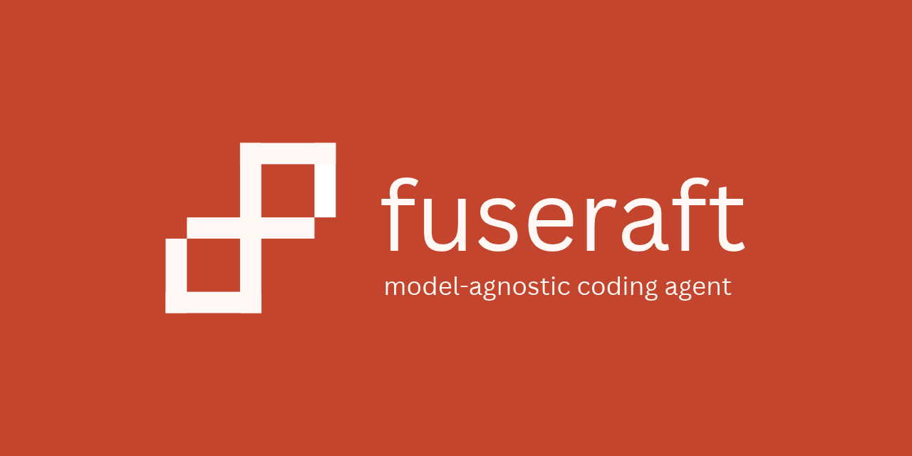
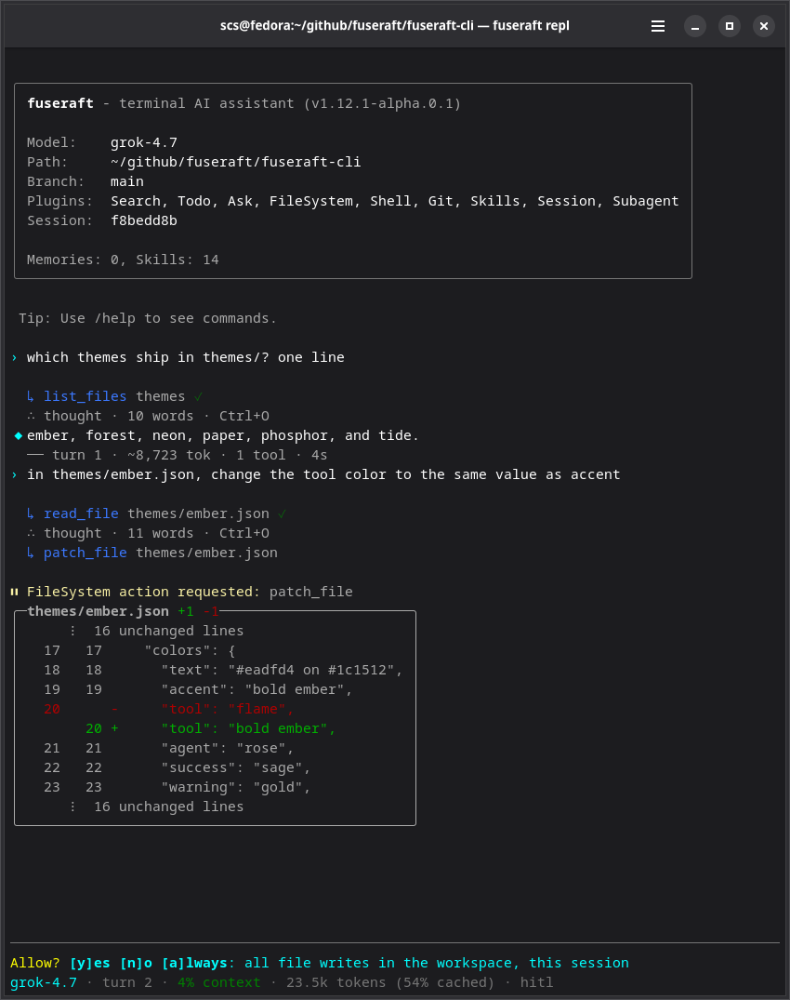
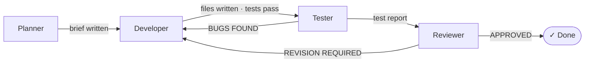

# fuseraft

[](https://github.com/fuseraft/fuseraft-cli/actions/workflows/ci.yml)
[](https://github.com/fuseraft/fuseraft-cli/releases)
[](LICENSE.md)



fuseraft is a coding agent for your terminal that works with any model. Run `fuseraft` and chat with a model that reads and edits your files, runs commands, searches your code and uses git, asking before it changes anything. Bring your own key for Anthropic, OpenAI, xAI, Google, Mistral, DeepSeek, Azure, Ollama, or any OpenAI-compatible endpoint.

When one agent isn't enough, fuseraft runs a team of them from a YAML file, and checks each agent's work (files on disk, test exit codes, tool-call records) before handing off to the next. Built on [Microsoft Agent Framework](https://github.com/microsoft/agent-framework).

**[Documentation](https://fuseraft.ai/fuseraft-cli/)** · [Getting started](https://fuseraft.ai/fuseraft-cli/getting-started/) · [Releases](https://github.com/fuseraft/fuseraft-cli/releases)



## Install

Prebuilt binaries are self-contained; you don't need .NET.

```bash
# Linux / macOS (end with `bash -s -- --system` to install to /usr/local/bin)
curl -fsSL https://raw.githubusercontent.com/fuseraft/fuseraft-cli/main/install.sh | bash
```

```powershell
# Windows
irm https://raw.githubusercontent.com/fuseraft/fuseraft-cli/main/install.ps1 | iex
```

Or download an archive from [Releases](https://github.com/fuseraft/fuseraft-cli/releases). `fuseraft update` keeps it current.

## Chat in your terminal

```bash
fuseraft              # start a chat in the current directory
fuseraft --resume     # pick up the last chat here
```

No config file needed: a setup wizard picks a provider and model on first run, and stores the key in your OS keychain.

- **Safe by default.** Commands, file writes and git changes ask first, with a diff for every edit, and the agent is confined to the directory you started in. `--yolo` turns both off.
- **Sessions you can come back to.** Every chat is saved; `/sessions` resumes one, `/fork` branches one, `/rewind` and `/undo` step back.
- **Plans, sub-agents and goals.** `/plan` and `/execute` for multi-step work, sub-agents for exploring the codebase, `/goal` to keep going until a goal is met.
- **Memory, skills and MCP.** It remembers what it learns across chats, loads portable skill packages, and connects to MCP servers (`/mcp add`).
- **Switch models mid-chat** with `/model`; `/help` lists every command.

More in the [REPL guide](https://fuseraft.ai/fuseraft-cli/repl/).

## Agent teams

`fuseraft run` drives a team of agents defined in YAML. Each one has its own model, instructions and tools, and routing validators block a handoff until the evidence exists: a brief on disk, the files the agent said it wrote, a passing test run.

```bash
fuseraft init --template pipeline    # Planner → Developer → Tester → Reviewer
fuseraft run -c .fuseraft/config/orchestration.yaml "Add JWT auth to the API"
fuseraft run --resume                # continue the last unfinished session
```



Teams can run in sequence, as a state machine or graph with parallel branches, under an LLM manager (Magentic), as generator-and-critic pairs, or as map-reduce and scatter-gather fan-outs. Every turn is checkpointed. `fuseraft init --list-templates` shows the other starting points (`solo`, `swe`, `debate`, …).

Start with [Configuration](https://fuseraft.ai/fuseraft-cli/configuration/), [Strategies](https://fuseraft.ai/fuseraft-cli/strategies/) and [Routing validators](https://fuseraft.ai/fuseraft-cli/validators/).

## Run it as a daemon

`fuseraft serve` keeps an agent team running and waiting for work. Other agents dispatch tasks to it over MCP; people attach with `fuseraft attach`, locally or from another machine over TLS with per-client tokens. Approvals go to whoever sent the task, and unattended changes are denied unless you allow them.

```bash
fuseraft serve
fuseraft attach    # from another terminal
```

See [Serve (daemon mode)](https://fuseraft.ai/fuseraft-cli/serve/).

## Beyond the terminal

- **[fuseraft for VS Code](https://github.com/fuseraft/fuseraft-vscode)** puts the same chat in a panel beside your editor, with native diff tabs for approvals.
- **[fuseraft-web](https://fuseraft.ai/fuseraft-web/)** runs fuseraft in the browser for a team: an account per person, shared approvals, and daemons on other machines.

Both drive the CLI through its versioned [wire protocol](https://fuseraft.ai/fuseraft-cli/protocol/), which you can use from your own scripts too (see [Scripting](https://fuseraft.ai/fuseraft-cli/scripting/)).

## Building from source

Requires the [.NET 10 SDK](https://dot.net).

```bash
./build.sh      # Linux / macOS; builds, runs the tests, and puts the binary in ./bin/
.\build.ps1     # Windows
```

## Contributing

Bug fixes, plugins, config examples and docs are all welcome. See [CONTRIBUTING.md](CONTRIBUTING.md).

## License

[MIT](LICENSE.md)
