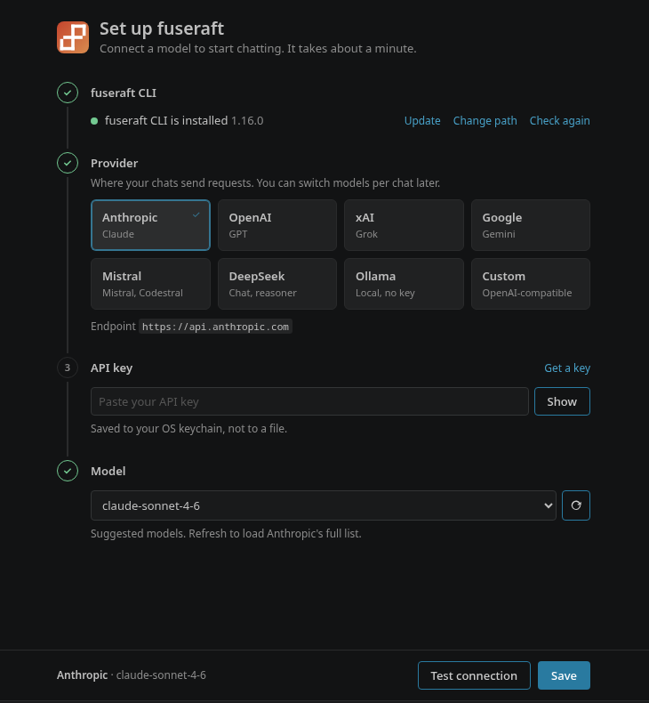

The setup screen connects the extension to a model. It opens by itself the first time, once the CLI is found, and any time after that from **fuseraft: Configure fuseraft** in the Command Palette or the **…** menu of the **Chats** view.

It walks through four steps. Each gets a check mark once it's done, and the footer keeps your current choice in view next to **Test connection** and **Save**.

---

## 1. fuseraft CLI

Shows whether the CLI was found, and its version.

- **Found:** **Update** runs `fuseraft update` in a terminal, **Change path** points at a different binary, and **Check again** looks again.
- **Not found:** the other steps stay locked. **Install the CLI** runs the official installer in a terminal, and the screen updates by itself once the binary appears. **Install it yourself** opens the install instructions, and **Set the path to it** is for a `fuseraft` that isn't on your `PATH`.

## 2. Provider

Pick where your chats send requests:

| Provider | Endpoint | API key |
|----------|----------|---------|
| Anthropic | `https://api.anthropic.com` | [console.anthropic.com](https://console.anthropic.com/settings/keys) |
| OpenAI | `https://api.openai.com/v1` | [platform.openai.com](https://platform.openai.com/api-keys) |
| xAI | `https://api.x.ai/v1` | [console.x.ai](https://console.x.ai) |
| Google | `https://generativelanguage.googleapis.com` | [aistudio.google.com](https://aistudio.google.com/apikey) |
| Mistral | `https://api.mistral.ai/v1` | [console.mistral.ai](https://console.mistral.ai/api-keys) |
| DeepSeek | `https://api.deepseek.com/v1` | [platform.deepseek.com](https://platform.deepseek.com/api_keys) |
| Ollama | `http://localhost:11434/v1` | None |
| Custom | Any OpenAI-compatible API | Optional |

For the named providers the endpoint is fixed and shown for reference. **Custom** asks for the base URL of an OpenAI-compatible API, usually ending in `/v1`. That covers LM Studio, vLLM, llama.cpp's server, LiteLLM, OpenRouter, and similar gateways.

The provider here is the default for new chats. You can switch models from a chat's header at any time without losing the conversation.

## 3. API key

Paste your key. **Get a key** opens the provider's key page, and **Show** reveals what you've typed.

- **Ollama** runs on your machine, so there's no key field.
- **Custom** servers often need no key. Leave it blank if yours doesn't.
- **A key is already saved for this server:** the field shows `(saved)`. Leave it blank to keep that key.

See [Where your key is kept](#where-your-key-is-kept) below.

## 4. Model

Pick a model, or choose **Other model…** and type its ID.

The list starts with a few suggestions for the provider. The refresh button next to it loads the provider's actual list using the key you entered, and the line below says where the list came from. For Ollama, it lists the models you've pulled. A Custom server that has no model list needs the model ID typed in.

---

## Test connection

**Test connection** checks the settings before you save them:

- **With a model chosen,** it sends that model a one-token request, so a wrong model ID shows up here and not in your first chat.
- **With no model chosen,** it lists the provider's models instead, and fills the model list on success.

A failure says why. For example: the provider's own error for a bad key, "Nothing answered at http://localhost:11434/v1. Is the server running?" for a server that isn't up, or "this endpoint doesn't list its models" for a Custom server without a model list. In that last case, enter the model ID and test again.

## Save

**Save** writes the provider, endpoint, and model to `~/.fuseraft/config` (only that section, through `fuseraft settings set`), and stores the key in your OS keychain. It then offers **Start a Chat**.

The settings are the CLI's, so `fuseraft repl` in a terminal uses the same provider and key. See [`fuseraft settings`](cli-reference.md#fuseraft-settings).

---

## Where your key is kept

API keys go in the OS keychain, never in a file: Windows Credential Manager, macOS Keychain, or GNOME Keyring on Linux (through `secret-tool`). If no keychain is available, Save stops with an error and the key isn't saved. Set the provider's key in an environment variable instead, and name it with `fuseraft settings set provider.apiKeyEnvVar <VAR>`. See [Security — API key storage](security.md#api-key-storage).

**Each key belongs to one server** (CLI 1.17.0 or later). A key is saved for the server it was entered for and only sent there. Switching provider doesn't take your old key along: the new server gets the key saved for it, or none. Switching back finds the old key again. The setup screen asks the CLI whether a key is saved for the server you've selected, and says what Save will do.

With an older CLI there's one key for every provider, and it goes to whatever server is configured. The setup screen warns about this when you switch providers with the key field blank. Update the CLI from the first step to fix it.

**A key from an older setup in plain text** in `~/.fuseraft/config` gets a warning. **Move it to the keychain** moves it and removes it from the file.

To change or remove keys outside the setup screen, use [`fuseraft keychain`](cli-reference.md#fuseraft-keychain) (`--set`, `--delete`, `--endpoint <URL>`).
