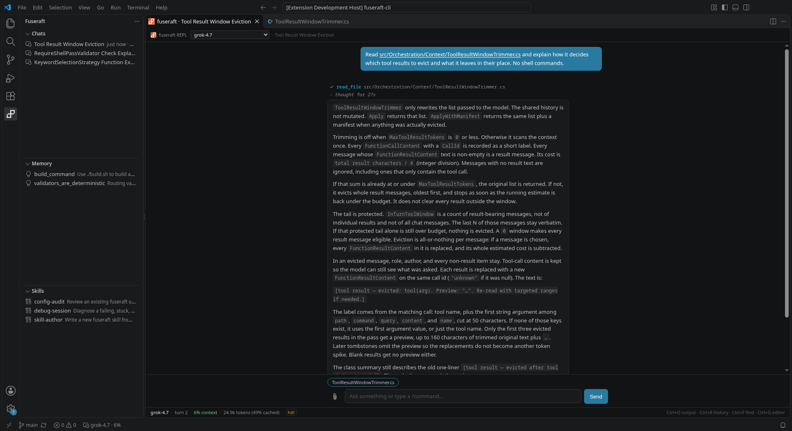

The fuseraft extension puts the [REPL](repl.md) in a VS Code panel. You chat with any model — Claude, GPT, Grok, Gemini, Mistral, DeepSeek, a local model through Ollama, or any OpenAI-compatible server — and it reads and edits your code and runs commands, asking first. It's the same agent as `fuseraft repl` in a terminal, with the editor wired in: you can hand it a selection or an error, approve its file changes as real diffs, and click the paths in its replies.



These pages cover:

- **[Setup & Providers](vscode-setup.md)** — the setup screen, choosing a provider, and where your API key is kept.
- **[Chat Panel](vscode-chat.md)** — following a turn, working with your code, approvals, and keyboard shortcuts.
- **[Reference](vscode-reference.md)** — the sidebar, every command and setting, and troubleshooting.

---

## Installing

Install **fuseraft** from either store. It's the same extension, published to both at once:

- [VS Code Marketplace](https://marketplace.visualstudio.com/items?itemName=fuseraft.fuseraft) — for VS Code.
- [Open VSX](https://open-vsx.org/extension/fuseraft/fuseraft) — for VSCodium and other editors that install extensions from Open VSX.

Or from a terminal:

```bash
code --install-extension fuseraft.fuseraft
```

**Requirements:** VS Code 1.85 or later, and the fuseraft CLI, which the extension can install for you. Use a current CLI. An older one still runs, but the panel shows less of each turn, and keeping each API key to its own server needs CLI 1.17.0 or later.

---

## First run

1. **The CLI.** The extension runs on the fuseraft CLI. If it isn't on your `PATH`, a notification offers to install it:
   - **Install** runs the official installer in a terminal: `curl -fsSL …/install.sh | bash` on Linux and macOS, `irm …/install.ps1 | iex` in PowerShell on Windows.
   - **Set Binary Path** points at a `fuseraft` that's installed somewhere else.
   - **Check again** picks it up once it's installed.
2. **Setup.** Once the CLI is found and no model is configured yet, the setup screen opens. Pick a provider, paste your API key, choose a model, and **Save**. See [Setup & Providers](vscode-setup.md).
3. **Chat.** Click **fuseraft** in the status bar, or **+** in the **Chats** view of the fuseraft sidebar. A new chat offers a few places to start from what you have open.

You can rerun setup at any time with **fuseraft: Configure fuseraft** from the Command Palette.

---

## Where things are

- **The chat panel** opens beside your editor. Each chat runs its own CLI process, started in your workspace folder.
- **The fuseraft sidebar** (the ƒ icon in the activity bar) has three views: **Chats** in this workspace, **Memory** the agent has kept, and **Skills** it can load. See [Reference — The sidebar](vscode-reference.md#the-sidebar).
- **The status bar item** follows the open chat. It shows the model and how full its context is, a spinner while it works, and a highlighted **approval needed** or **question for you** when it's waiting on you. Click it to go to the chat.

---

## How it relates to the CLI

The panel starts `fuseraft repl --vscode` in your workspace and talks to it over a JSON bridge (see [Wire Protocol](protocol.md)). So everything the terminal REPL does applies here too:

- **Configuration:** the same `~/.fuseraft/config` (see [`fuseraft settings`](cli-reference.md#fuseraft-settings)), API keys in the same OS keychain, the same `/commands`, skills, memory, and MCP servers.
- **Safety:** safe by default, as in the terminal. Changes ask first, and the agent is sandboxed to the workspace folder unless `repl.yolo` is set. See [Security & Sandbox](security.md).
- **Chats:** saved the same way. A chat started in the panel can be resumed from a terminal with `fuseraft repl --resume <id>`, and one started in a terminal in this folder shows up in the **Chats** view.

Extra folders in a multi-root workspace are passed to the agent with `--include`, so it can work across all of them.

Multi-agent orchestration (`fuseraft run`) isn't part of the extension. Run it from a terminal; see [Getting Started](getting-started.md).
